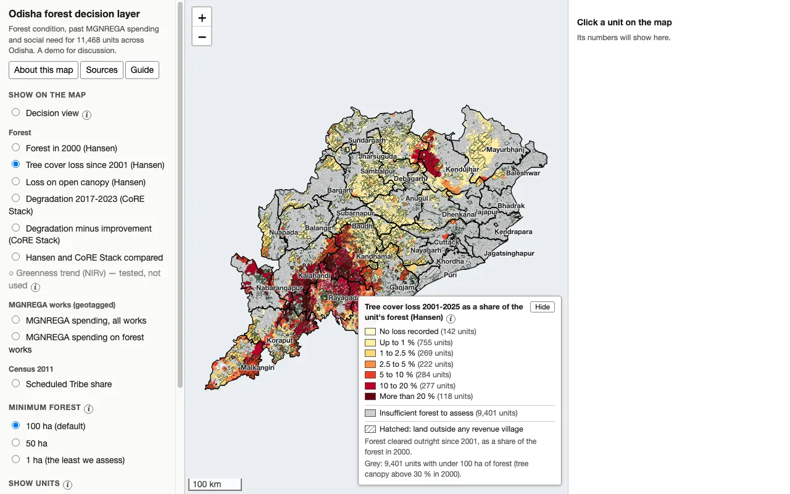
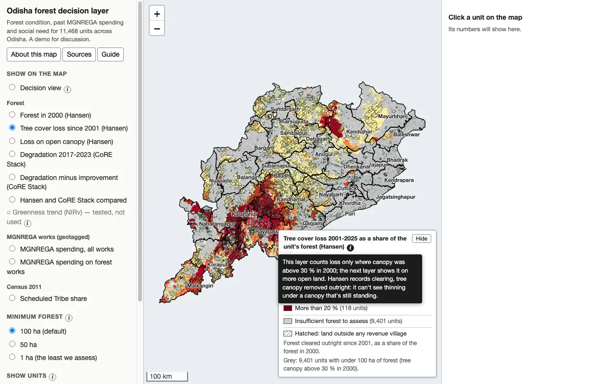
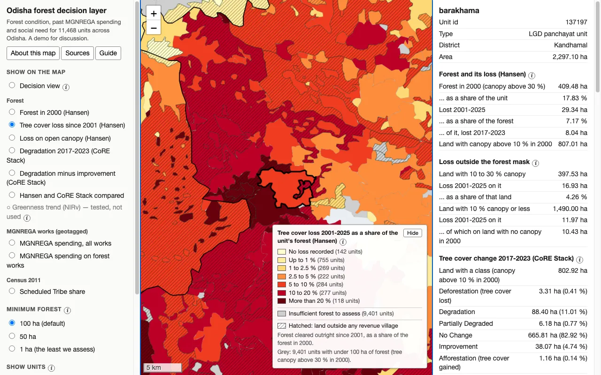
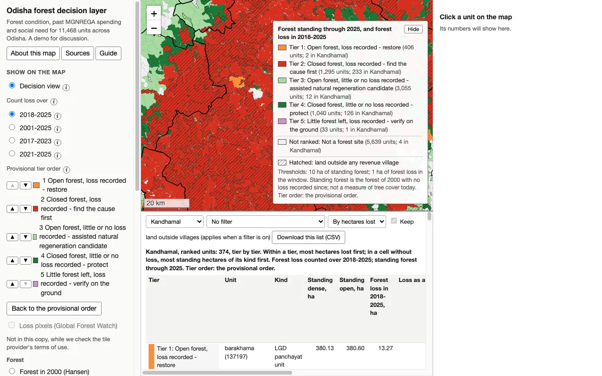
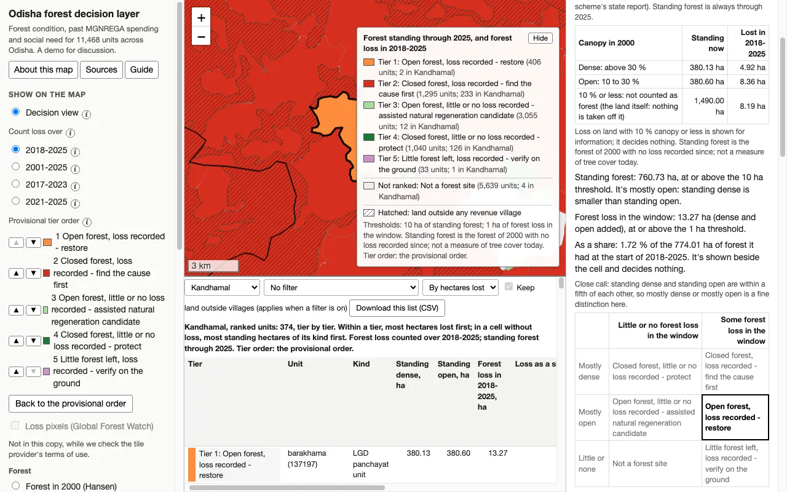

# A guide to this map

The Odisha forest decision layer is a web map of 11,468 units covering Odisha, live at [sudo-karan.github.io/ICTD_Project](https://sudo-karan.github.io/ICTD_Project/). For each unit it shows forest condition, past MGNREGA spending and social need, and it places every unit in one of six cells that point to a kind of forest work. It is a starting point to check against what people who know the ground see, not a verdict on any place.

## What the map is for

The map sets three things side by side for every part of Odisha: forest and its loss, who lives there, and what the rural employment scheme spent there. The question behind it is Prof. Aaditeshwar Seth's: "determine which areas have seen forest degradation, are also marginalised, and have they seen good enough resource allocation in the past".

It follows a suggestion in the Commons Connect paper (Mehta et al., ICTD 2024). That paper describes a water-security tool built on the CoRE Stack and says similar tools could be built for forest conservation and restoration. This map is a first step toward such a tool for forests: datasets, indicators for each unit, and one view of them.

For each unit the map shows:

- forest in 2000 and its loss since 2001, from Hansen's Global Forest Change (University of Maryland);
- tree cover change from 2017 to 2023, from the CoRE Stack;
- whether those two measures agree;
- MGNREGA spending on the works geotagged inside the unit;
- Census 2011 population, households, and Scheduled Tribe and Scheduled Caste shares;
- in the decision view, one of six cells that each point to a kind of forest work, with a district's units listed in a provisional order.

**What a unit is.** Units are administrative, because MGNREGA funds and the census are administrative. There are 7,976 LGD panchayat units, each the villages mapped to one panchayat id in the government's LGD directory (not always a whole gram panchayat). There are also 3,492 outside-village units: land outside any revenue village, drawn hatched.

Outside-village units are 27 % of the area mapped but hold 59 % of its forest and 57 % of its forest loss. They have no census rows.

**No score.** The map has no index, no weights and no number out of a hundred. Need and past spending are shown beside a unit's cell, never folded into it.

## Opening it

Open [sudo-karan.github.io/ICTD_Project](https://sudo-karan.github.io/ICTD_Project/) in a browser on a laptop or desktop. The page carries about 22 MB of data, so the first load can take a moment on a slow connection. While the data loads, the page says so; then it says it is drawing the units, and the map appears.

It also works without a connection. Download `index.html` and `data.js` from the [site folder of the repository](https://github.com/sudo-karan/ICTD_Project/tree/main/site), keep them together in one folder, and open `index.html`. It needs nothing installed, and once loaded it asks no other site for anything.

It was checked in Chrome, and in WebKit (the engine of Safari), on a laptop. It does not work on a phone yet: at phone width the map gets no room between the two side panels.

The copy published online leaves out two things the full version has. One is the loss-pixel overlay from Global Forest Watch, held back while two points of its terms of use are unresolved. The other is a layer of 2011 that no file we share carries. Everything else is the full version's own.

## The screen at a glance

The page has three areas, and a fourth opens under the map in the decision view.

*The page as it opens: the controls on the left, the map with its legend in the middle, and the unit panel on the right.*

| Area | What it holds |
| --- | --- |
| Left panel | The title, the **About this map**, **Sources** and **Guide** buttons, and every control: the decision view, the map layers, the minimum forest, which units to show, and Find. |
| Map | The 11,468 units coloured by the layer chosen, black district outlines, and hatching on land outside villages. It has + and − to zoom, a scale bar and a legend. There is no background map. |
| Right panel | The numbers of the unit you click, or a prompt to click one. |
| Ranked list, under the map | In the decision view only: one district's units, tier by tier, with the list's own controls. |

## Every control and what it does

Every control changes only what is shown. The page looks its figures up from tables built beforehand; the only counting it does is of rows in a list, matches of a search and a tier's place in the order.

### Left panel

| Control | What it does |
| --- | --- |
| **About this map** (button) | Opens a window on how the map was made and how to read it. **Close**, or a click outside the window, shuts it. |
| **Sources** (button) | Opens the data sources and their licences in the same window. |
| **Guide** (button) | Opens this guide in the same window. The guide is `docs/GUIDE.md` in the repository, turned into the page's own HTML when the page is built, so it opens without a connection. |
| **Show on the map** (round buttons) | Picks the one layer the map is coloured by: six forest layers, two of MGNREGA spending and one from the census. "Greenness trend (NIRv)" is greyed out: tested, not used. |
| **Decision view** (round button, top of Show on the map) | Colours the map by the six cells instead of a layer. It adds its own controls below it and opens the ranked list under the map. |
| **Minimum forest**: 100 ha (default), 50 ha, 1 ha | On the forest layers, a unit with less than this of the land a layer is measured on is grey ("insufficient forest to assess"), not coloured. 100 ha is the minimum used in the analysis; the other two show what it hides. |
| **Show units**: Panchayat units (7,976), Land outside villages (3,492) | Draws or hides each kind of unit. |
| **Find**: district list | Zooms the map to that district. |
| **Find**: search box | Type a unit's name or id and press Enter. The map zooms to the unit, outlines it and opens its panel. If several match, it shows the first; add more of the name, or use the id. |
| **ⓘ** beside a label | A short note on what the label leaves out. Point at it, click it or reach it with Tab; Esc closes it. |

### On the map

| Control | What it does |
| --- | --- |
| Click a unit | Outlines it in black and shows its numbers in the right panel. |
| **+** and **−**, drag | Zoom in and out; drag to move the map. |
| Legend, **Hide** / **Show** | Names each colour and how many units have it. **Hide** folds the legend away to show the map under it, and the same button brings it back. In the decision view the legend also states the window, both thresholds and the tier order in use. |

*The note behind the legend's ⓘ, open.*

### Decision view controls (left panel)

| Control | What it does |
| --- | --- |
| **Count loss over**: 2018-2025 (default), 2001-2025, 2017-2023, 2021-2025 | Sets which years of forest loss count toward a unit's cell. Standing forest always runs to 2025. 2018-2025 starts after plantation fell out of spending in the scheme's state report; 2017-2023 matches CoRE Stack's window. |
| **Provisional tier order**, ▲ and ▼ | Moves a cell up or down the order. The map, the legend, the list and any download follow your order. |
| **Back to the provisional order** | Restores the provisional order. |
| **Loss pixels (Global Forest Watch)** | Greyed out in the copy published online (see Opening it). |

### The ranked list (under the map, decision view only)

| Control | What it does |
| --- | --- |
| **Pick a district…** | Ranks that district's units tier by tier and zooms the map to the district. There is no state-wide list. |
| Filter: **No filter**, **Scheduled Tribe share 18 % or more**, **above 33 %**, **more than 50 %** | Leaves out units with a smaller Scheduled Tribe share, or with no resident population in the 2011 census. It filters the list and never orders it. The 18 % and 33 % breaks are the ones CoRE Stack's Know Your Landscape dashboard uses. |
| **By hectares lost** / **By share lost** | Orders units within a tier: most hectares lost first, or the biggest share of the unit's forest lost first. Cells with little or no loss stay ordered by standing hectares either way. |
| **Keep land outside villages** | Works only when a filter is on. Outside-village units have no census data to filter on: ticked, they stay in the list; unticked, they are left out. |
| **Download this list (CSV)** | Saves the list as it stands as `ranked_<district>_<window>.csv`, with 32 columns. Every row carries the window, both thresholds, the tier order and any filter that made it. |
| Click a row | Shows that unit on the map and opens its panel. |

**Sharing a view.** The address in the browser's bar changes as you work. It records the layer, the minimum forest, the units shown and the unit chosen; in the decision view, also the window, tier order, district, filter and sort. Copy it to send someone exactly what you see. A link that ends in `#open=about`, `#open=sources` or `#open=guide` opens that window.

## The map layers

The map is coloured by one layer at a time; the page opens on **Tree cover loss since 2001 (Hansen)**. Each layer's legend counts the units in every class, and its ⓘ holds the caution in the last column below.

| Group | Layer | What it shows | Read it with this in mind |
| --- | --- | --- | --- |
| Forest | Forest in 2000 (Hansen) | Forest in 2000 (canopy above 30 %) as a share of the unit. | It is the land the next layer's loss is counted on. It is not Odisha's recorded forest area, nor the Forest Survey's forest cover. |
| Forest | Tree cover loss since 2001 (Hansen) | Forest cleared outright from 2001 to 2025, as a share of the forest of 2000. | It counts loss only where canopy was above 30 % in 2000. Hansen records canopy removed outright; it can't see thinning under a canopy that still stands. |
| Forest | Loss on open canopy (Hansen) | Loss from 2001 to 2025 on land with 10 to 30 % canopy in 2000, as a share of that land. | 45 % of all Hansen loss in these units is outside the 30 % forest mask; this band is the part of it that stood as trees in 2000. |
| Forest | Degradation 2017-2023 (CoRE Stack) | Land where canopy density or tree height dropped a class, as a share of the land CoRE Stack classes, on land with canopy above 10 % in 2000. It shows thinning that Hansen can't see. | A pixel is marked when a classifier that is right about two times in three says it crossed its zone's threshold. Read it next to Improvement, which carries the same noise the other way. |
| Forest | Degradation minus improvement (CoRE Stack) | Where degradation outweighs improvement; near zero means no net signal. | Both classes carry the same classifier noise, so the net is the safer reading. |
| Forest | Hansen and CoRE Stack compared | For units with at least 100 ha of land with canopy above 10 % in 2000: whether each measure puts the unit in its top fifth. | It is about units, not hectares: the two haven't been overlaid pixel by pixel. Units wholly under CoRE Stack's East Coast zone model are a class of their own, because our placebo test fails there, though on few districts. |
| Forest | Greenness trend (NIRv) | Greyed out: tested, not used. | A Landsat 8 greenness trend (2013-2025) was tested as a measure of thinning. Its result depended on how each image's date was corrected for, and one image could flip a pixel's flag. |
| MGNREGA works (geotagged) | MGNREGA spending, all works | Spending on all works geotagged inside the unit, in rupees lakh. It is a total for the unit, not per person. | The geotagged record effectively ends with works started in 2017-18. It counts works whose recorded location falls in the unit, not what the panchayat of record received: only 65 works in 100 lie in the unit holding most of their panchayat's works. |
| MGNREGA works (geotagged) | MGNREGA spending on forest works | Spending on works typed as afforestation, forest protection, eco-restoration of forest or forestry plantation: 1.1 % of all spending in these units. | The wider Plantation category (15 %) includes orchards; each unit's panel shows it. |
| Census 2011 | Scheduled Tribe share | Share of the unit's 2011 population that is Scheduled Tribe. | Outside-village units read "no census data for this land", never zero. |

Grey on a forest layer means **insufficient forest to assess**: the unit has less than the minimum forest (100 ha by default) of the land the layer is measured on. A loss rate on a few hectares is mostly noise. Between odd and even years the rank correlation of a unit's loss rate is 0.34 for units with 1 to 2 ha of forest and 0.61 at 5 to 10 ha. At 100 ha, 9,401 units are grey on the Hansen loss layer, and the coloured units still hold 97.0 % of the forest.

## A unit's panel

Click a unit and the right panel lists every figure the map holds for it, in seven blocks. Areas are the unit's true areas, not those of the simplified shape drawn on the map.

*A unit clicked on the map: its black outline, and its numbers in the panel on the right.*

| Block | What it holds | Note behind its ⓘ |
| --- | --- | --- |
| Heading | Unit id, type (LGD panchayat unit or outside-village unit), district, area. | |
| Forest and its loss (Hansen) | Forest in 2000 (canopy above 30 %) and its share of the unit; loss from 2001 to 2025 and its share of the forest; the part lost from 2017 to 2023; land with canopy above 10 % in 2000. | Global Forest Change v1.13, 30 m pixels; areas are sums of pixel areas inside the unit. A yellow note appears when the unit has under 100 ha of forest. |
| Loss outside the forest mask | Land with 10 to 30 % canopy and the loss on it; land with 10 % canopy or less and the loss on it, and how much of that was on land with no canopy at all in 2000. | Loss on land with no canopy in 2000 is tree cover that grew after 2000 and was removed, or an artefact of detection. |
| Tree cover change 2017-2023 (CoRE Stack) | The land CoRE Stack classes; its six classes in hectares and per cent, with a bar; degradation minus improvement; degradation on all land CoRE Stack covers; its tree cover at the start. | Read from CoRE Stack's raw Earth Engine layer (25 m). CoRE Stack's published block rasters take Deforestation and Afforestation from its land-use maps, so their figures for those two will differ. Only Deforestation was validated by its producers. |
| Hansen and CoRE Stack compared (2017-2023) | The result of the headline comparison and of the comparison with every unit kept; CoRE Stack's zone model for the unit's land; each measure's rate. | A unit is compared if it has at least 100 ha of this land on both grids, and flagged if its rate is in the top fifth. A flag is relative, not an amount of damage. |
| MGNREGA works geotagged here | Number of works; spending on all works; the Plantation category (includes orchards); works typed as forest or forestry; water works. | The three lines under the total overlap: don't add them. Works started 2006-07 to 2017-18 in the main. |
| Census 2011 | Population, households, Scheduled Tribe share, Scheduled Caste share. | Village rows summed over the unit's villages. Land outside villages has no census rows. |

In the decision view, a **Why this tier** block comes right after the heading. It is described in the next section.

## The decision view

The decision view puts every unit in one of six cells by asking Hansen's record two questions, then lists one district's units tier by tier. It changes nothing in the layers; it reads the same measurements a second way.

*The decision view with one district ranked: the window and the tier order on the left, the legend with each tier's count, and the list under the map.*

### The two questions

1. **How much forest stands now, and is it mostly closed or mostly open?** Standing forest is the land under canopy in 2000 on which Hansen records no loss through 2025: dense where canopy was above 30 %, open where it was 10 to 30 %. Under 10 ha standing is "little or none"; otherwise the larger of standing dense and standing open decides.
2. **Was forest lost in the window?** The window's loss from dense and open land together: 1 ha or more is "some", under 1 ha is "little or none".

The two thresholds were set on 9 October 2026. 1 ha is the smallest patch the Forest Survey of India counts as forest cover, and about 14 Hansen pixels, so that a single pixel can't decide a cell. Units with 10 ha or more standing hold 99.6 % of all standing forest.

The thresholds matter. In 2018-2025, moving the standing minimum to 5 ha or 25 ha moves 990 or 1,207 units to another cell; moving the loss minimum to 0.5 ha or 2 ha moves 308 or 282.

### The six cells

| Forest standing now | Little or no forest loss in the window | Some forest loss in the window |
| --- | --- | --- |
| Mostly dense | Closed forest, little or no loss recorded - protect | Closed forest, loss recorded - find the cause first |
| Mostly open | Open forest, little or no loss recorded - assisted natural regeneration candidate | Open forest, loss recorded - restore |
| Little or none | Not a forest site | Little forest left, loss recorded - verify on the ground |

| Provisional tier | Cell | Units, 2018-2025 | Of them outside villages | Work it points to, in the list of permissible works |
| --- | --- | --- | --- | --- |
| 1 | Open forest, loss recorded - restore | 406 | 112 | Plantation (Sl. 105, 108, 110), bamboo (Sl. 91), contour trenches (Sl. 121, 123), forest fire management (Sl. 372, 373, 374). |
| 2 | Closed forest, loss recorded - find the cause first | 1,295 | 550 | The cause first; no row of the list is a way of finding it. If the cause is fire: forest fire management (Sl. 372, 373, 374). |
| 3 | Open forest, little or no loss recorded - assisted natural regeneration candidate | 3,055 | 614 | Assisted natural regeneration is in none of the list's 375 rows. Rows that could support it: contour trenches (Sl. 121, 123) and forest fire management (Sl. 372, 373, 374). |
| 4 | Closed forest, little or no loss recorded - protect | 1,040 | 514 | Protection, not planting: forest fire management (Sl. 372, 373, 374). |
| 5 | Little forest left, loss recorded - verify on the ground | 33 | 14 | None until the recorded loss has been seen on the ground. |
| Not ranked | Not a forest site | 5,639 | 1,688 | None. |

The list is the Ministry of Rural Development's notification S.O. 5448(E) of 5 October 2026: the 375 permissible works under the VB-G RAM G Act. No row of it names forest land, so which rows bear on a cell is this project's proposal. Serial numbers were read from the page images of the Gazette.

### The tier order

The order is provisional, and you can change it on the page. Tier 1 is open forest with loss recorded, because there the standing canopy is thinnest: restoration has the most to hold on to and the most to lose by waiting. Tier 2, closed forest with loss recorded, needs its cause found before any work is planned; a forester could reasonably put it first.

### Ranking within a district

Units are ranked only within one district, never across the state. Among the 1,649 LGD panchayat units of the comparison's headline, the two forest measures agree within districts (odds ratio 2.84, interval 1.92 to 5.24). Across the state their agreement is not established (1.55, 0.80 to 3.61).

- **Within a tier**, units with the most hectares lost come first, or, by choice, the biggest share lost. Cells without loss are ordered by standing hectares of their kind.
- **Loss as a share** is the window's loss as a percentage of the forest the unit had at the window's start. It stands beside the cell and decides nothing. A fixed 1 ha bar is easier for a large forest to cross: 349 of the 1,295 units in tier 2 lost under 1 % of their forest in 2018-2025.
- **No share** is given where a unit had under 10 ha of forest at the window's start; the page says so in words.
- **Close call** marks units whose standing dense and standing open are within a fifth of each other: 603 of the 5,796 units with 10 ha or more standing.

### Why this tier, in the panel

In the decision view, a unit's panel walks through its cell: the window, a small table of its forest by canopy band (in 2000, standing now, lost in the window), each test against its threshold, the share, the grid with its cell, and its tier. Then come its corroboration, the work types, and the facts its district rests on.

*A unit's panel in the decision view, at Why this tier: its forest by canopy band, each test against its threshold, and the grid with its cell.*

- **Corroboration** says what the comparison of Hansen with CoRE Stack found for the unit in 2017-2023, whatever window is chosen: both measures flag it, one does, neither does, or it was not compared and why. Under CoRE Stack's East Coast zone model the badge adds that corroboration is unreliable there.
- **Land outside villages** is classed and listed like any unit: in 2018-2025, 1,804 outside-village units are in a cell other than Not a forest site. Their panel asks "Outside every revenue village. Whose plan covers this land?"

## How we built it

The page is the last step of a chain of Python scripts. They turn public data into tables with one row per unit, check every table, and build a page that only looks its figures up.

### The data

| What | Source | Licence or terms |
| --- | --- | --- |
| Tree canopy in 2000 and tree cover loss 2001-2025 | Hansen, Potapov, Moore, Hancher et al., Global Forest Change v1.13 (University of Maryland), through Google Earth Engine. The state's canopy of 2000 and its loss for 2001-2020 were reconciled to Global Forest Watch's published figures, which stop at 2020. | CC BY 4.0 |
| Tree cover change 2017-2023 | CoRE Stack (Commoning for Resilience and Equality), ACT4D group, IIT Delhi | CC BY 4.0 |
| Population, households, Scheduled Tribe and Scheduled Caste population | Census of India 2011, village rows as compiled by the ICTD group, IIT Delhi | Government of India; compilation CC BY 4.0 |
| MGNREGA works and spending | Ministry of Rural Development: geotagged assets (Bhuvan GeoMGNREGA), as published by CoRE Stack; MIS report R6.20 for state figures | Government of India public data; compilation CC BY 4.0 |
| Unit boundaries | DataMeet's Indian village boundaries (Odisha), joined to LGD panchayat ids | ODbL 1.0; the shapes in the page are a database derived from DataMeet's, under the same licence |
| Work types | Ministry of Rural Development notification S.O. 5448(E), 5 October 2026, Gazette of India | Government of India; no licence stated |
| Forest cover, for comparison only | Forest Survey of India, India State of Forest Report 2023 (no figure of it is on the map) | © Forest Survey of India; non-commercial use with acknowledgment |
| Cautions about Hansen's data, quoted on the page | Global Forest Watch's dataset record and the University of Maryland's page for version 1.13, read on 8 October 2026 | Short quotations with their sources |
| The map library | Leaflet 1.9.4, embedded unmodified | BSD 2-Clause |

The analysis also used SHRUG 2.2's small-area poverty estimates (Development Data Lab, CC BY-NC-SA 4.0). No figure derived from them is in the shared page, so that the page does not become a derived work under that licence.

### The units

- **Panchayat units.** DataMeet's 52,531 village polygons were joined to the LGD mapping of villages to panchayats. The villages of one panchayat id make one unit: 7,976 in all.
- **Land outside villages.** Land outside any revenue village makes 3,492 more units. Each takes the district named on its boundary polygon, checked against the panchayat polygons under it and the villages round it.
- **Villages in no unit.** 161 villages (753 km²) have a census code but no row in the village-to-panchayat mapping. They belong to no unit and show as blank patches.
- **Simplified shapes.** To keep the file small, the boundaries were simplified from 2,447,144 points to 1,232,815, with a 30 m tolerance and shared edges kept shared. A unit's drawn area changes by 0.022 % at the median.

### The stages

1. **Units.** `01_build_units.py` builds the two kinds of unit; `01_assign_outside_district.py` gives each outside-village unit a district.
2. **Forest.** In Google Earth Engine, pixel areas are summed inside every unit. `02_build_hansen.py` takes Hansen's forest at several canopy thresholds and its loss by year and canopy band. `02_build_corestack.py` takes CoRE Stack's change classes for 2017-2023. `02_build_agreement.py` sets the two side by side, unit by unit.
3. **Need.** `03_build_need.py` sums the census village rows over each unit.
4. **Spending.** `04_build_allocation.py` places each geotagged work in the unit it falls in, and matches the totals to the rupee. `04_compare_dump_to_r620.py` sets the record beside the scheme's state report, R6.20, by district and year.
5. **Decision tables.** `05_build_decision.py` puts every unit in a cell for each of the four windows, from the forest hectares alone.
6. **The page.** `06_build_layer.py` writes one HTML file, with Leaflet inside it, and one data file. Every value shown is formatted in Python beforehand, and this guide is turned from `docs/GUIDE.md` into the page's own HTML.
7. **The shared copy.** `07_build_share.py` makes this copy from the full version: it leaves one 2011 layer out and switches the overlay off.
8. **Publishing.** `publish_site.sh` copies the checked copy into the `site/` folder and pushes the code. A GitHub Actions workflow then puts it on GitHub Pages.
9. **The analysis.** The `08_` scripts set need beside past spending, district by district (see What the analysis behind it found).

### The main choices

- **Forest** is canopy above 30 % in 2000, Hansen's own forest mask. The open band of 10 to 30 % is shown on its own, and land with 10 % canopy or less is not counted as forest.
- **The minimum forest of 100 ha** for any loss rate was set on 7 October 2026. Below it, a rate may not repeat from one set of years to the next.
- **The greenness trend (NIRv)** was dropped on 7 October 2026: its result depended on how image dates were corrected for.
- **The decision view's thresholds**, 10 ha standing and 1 ha of loss, were set on 9 October 2026, with the share shown beside the cell.
- **The default window starts in 2018.** In the state report, plantation was 24.2 % of spending in FY2016-17 and 3.3 % in FY2018-19.
- **The comparison's headline leaves out units wholly under CoRE Stack's East Coast zone model.** Our placebo test fails there: clearance goes with CoRE Stack's Improvement class, which it should not. The failure is a strong pattern in few districts, not an established fact.

## How it was checked

Every check below passed on this build before it was published. Each verifier rebuilds the figures its own way and compares them with what was built.

| Check | What it does | Result |
| --- | --- | --- |
| `verify_layer.py` | Rebuilds every field the page shows, for every unit, from the stage tables. | 92 of 92 checks; 11,468 units, 44 fields each |
| `verify_decision.py` | Re-adds every hectare of the decision view from the yearly figures, and re-derives every cell, order, share and count. | 62 of 62 checks; 4 windows, 6 cells, 30 districts |
| `verify_agreement.py` | Rebuilds the arithmetic of the Hansen and CoRE Stack comparison from the two sources. | 41 of 41 checks |
| `exercise_layer.py`, in Chrome and in WebKit | Works every control of the page, clicks units on the map, and compares each value shown with the tables. | 53 of 53 control actions in each browser; 1,276 of 1,276 values shown equal the tables; no script error |
| `exercise_decision.py`, in Chrome and in WebKit | Works every control of the decision view, opens units of all six cells, and checks two downloaded lists cell by cell. | 53 of 53 steps in Chrome, 47 of 47 in WebKit; 874 of 874 lines of "why this tier" as the tables give them; every cell of both downloads correct |
| `exercise_share.py` | Holds the shared copy to the full version, less one 2011 layer and with the overlay off. | 8 of 8 steps; no request to the network |
| `check_site_copy.py` | Holds the page's words against copies saved before they were rewritten: no figure, class, count or colour moved. It also traces every figure in this guide to the file it comes from. | 51 of 51 checks |
| `verify_gap.py` | Recomputes every table of the analysis from its inputs. Then 42 deliberate errors were planted in copies of its files, one at a time. | 338 of 338 checks; 42 of 42 planted errors caught |
| `check_pages_live.py` | Fetches the live site and holds its bytes to the build. Then it opens the site in a fresh browser, counts the units drawn and watches for errors and requests to other sites. | Run after every publication: 9 checks |

The Safari application itself was not run in the last batch of changes; the WebKit runs, the engine Safari uses, stand in for it.

## What the analysis behind it found

Across Odisha's 30 districts, plantation money broadly rose with forest loss, but the districts with the most loss got well under their share. The analysis describes where money went relative to where forest was lost; it says nothing about why.

It compares two things by district, because current spending exists only by district, in the scheme's state report R6.20. **Need** is the forest loss of 2018-2025, summed over the units where loss is recorded. **Allocation** is plantation spending from FY2018-19 to FY2025-26. Its full account is `docs/GAP.md` in the repository.

| Question | Finding |
| --- | --- |
| Where is the need? | 67.1 % of it lies in 5 districts that each got under half their share of the money: Kandhamal, Gajapati, Kalahandi, Koraput and Malkangiri. 66,060 ha, 74 % of the need, lies in districts that got less than their share. |
| Do need and money rise together? | Yes, but not one for one: Spearman's rho is 0.67 (95 % interval 0.38 to 0.84). District size alone, read through all spending, gives 0.57 (0.30 to 0.75). With size taken out of both sides, rho is 0.37 (0.01 to 0.63). |
| What about marginalised districts? | The 8 districts where over half the people are Scheduled Tribe hold 78.1 % of the need and got 57.7 % of the money. |
| How much would move if money followed need? | Splitting the same money by need would move ₹72.07 crore of the ₹139.16 crore spent between districts. |
| Does spending follow the previous year's loss? | No sign of it: plantation's share of a district's spending moves 0.226 points per 100 ha of loss the year before, with an interval of −0.065 to 0.893 (p 0.383). |
| Did units with forest works lose less forest later? | No: units with forest-named works by FY2017-18 lost no less of their forest in 2018-2025 (−0.14 points, interval −0.48 to 0.20). |
| Does the need match the Forest Survey? | It does not track the Survey's net change in forest cover from 2021 to 2023 (rho −0.20, −0.54 to 0.22). It does track the Survey's scrub (rho 0.81, 0.60 to 0.92). |

Much gross loss beside little net change could mean rotational clearing: shifting cultivation, or plantations harvested and replanted. Nothing in these tables can test that reading.

## Limits to keep in mind

These limits apply to every figure on the map.

- **Standing forest is not tree cover today.** It is the forest of 2000 with no loss recorded since. Regrowth and gain are not counted, and recorded loss is itself uncertain.
- **Hansen's loss is not deforestation.** It records tree cover removed or killed, by harvest, fire, disease or storm. Tree cover is any vegetation taller than 5 m, so plantations count as forest.
- **Hansen can't see thinning.** It records canopy removed outright, so its loss is a floor.
- **Hansen has known errors.** Its producers found 13 % false positives and 12 % false negatives, varying by biome. They are 75 % confident that a loss falls in its stated year, and 97 % confident that it falls within a year either side.
- **Hansen's record changed method in 2011.** The earlier years were not reprocessed, so long time series need care.
- **CoRE Stack's classes are noisy.** Its classifiers are right about two times in three, and only its Deforestation class was validated by its producers. Its two zone models differ, so part of the map follows the zone boundary.
- **The two measures agree only modestly.** For LGD panchayat units alone, agreement across the state is not established (odds ratio 1.55, interval 0.80 to 3.61). They are compared unit by unit, not pixel by pixel.
- **The spending record ends early.** The geotagged works record effectively ends with works started in 2017-18. It shows where works were located, not what a panchayat received.
- **The census is from 2011,** and land outside villages has none.
- **A unit is a shape on a map, not a jurisdiction.** What the land outside villages is in law isn't in the data used.
- **The tier order is provisional** and the work types are this project's proposal. There is no score.
- **It needs a laptop screen.** It doesn't work at phone width, and at 1280 × 800 the ranked list is wider than its panel and scrolls sideways.

## The code and the documents

All the code is public in one branch, `main`, of [github.com/sudo-karan/ICTD_Project](https://github.com/sudo-karan/ICTD_Project). The published page is its `site/` folder, and `.github/workflows/pages.yml` puts that folder online.

| File | What it covers |
| --- | --- |
| `README.md` | The pipeline: every script, what it reads and writes, and how to run it. |
| `docs/GUIDE.md` | This guide; the page shows it under **Guide**. |
| `docs/UNITS.md` | How the units were built. |
| `docs/DEGRADATION.md` | The forest measures, Hansen and CoRE Stack, and how they compare. |
| `docs/NEED.md` | The census figures for each unit. |
| `docs/NRM.md` | Why there is no natural-resource-management spending column per unit. |
| `docs/LAYER.md` | The map page, its layers and its checks. |
| `docs/DECISION_LAYER.md` | The decision view: every rule, threshold, count and decision behind it. |
| `docs/RESULTS.md` | Every headline number, each with its caveat. |
| `docs/GAP.md` | The analysis of need against past spending. |
| `docs/DATA_NOTES.md` | What was checked in the data, when and how. |
| `docs/SITE_COPY.md` | The page's words: what was untrue on 11 October 2026 and what it says now. |
| `docs/stage4_run_log.md` | The log of the analysis runs. |

`docs/RESULTS.md`, `docs/GAP.md` and `docs/DECISION_LAYER.md` are written by scripts, and no figure in them was typed by hand. Each figure names the table it was read from.

The raw downloads and the stage tables are not in git, because they are large and can be fetched or rebuilt. `scripts/collect_data.py` lists and fetches the raw files; it has so far been tested only against a mock server.

To publish a new build, run `bash scripts/publish_site.sh` from the repository, then `.venv/bin/python scripts/check_pages_live.py --wait 10` to check what the site serves.

## Sources

Figures are those of this build and of the checks run on it.

- [The map](https://sudo-karan.github.io/ICTD_Project/)
- [The repository](https://github.com/sudo-karan/ICTD_Project)
- [Global Forest Change v1.13, University of Maryland](https://storage.googleapis.com/earthenginepartners-hansen/GFC-2025-v1.13/download.html)
- [Hansen et al. 2013, High-resolution global maps of 21st-century forest cover change, Science 342: 850-853](https://pubs.usgs.gov/publication/70048671)
- [Global Forest Watch's record of the Tree cover loss dataset](https://data-api.globalforestwatch.org/dataset/umd_tree_cover_loss), the source of the cautions quoted on the page
- [CoRE Stack](https://core-stack.org)
- [Goyal, Chauhan and Seth, Scalable Monitoring of Tree Canopy Density and Height in India at High Spatial Resolutions, ICTD 2024](https://www.cse.iitd.ernet.in/~aseth/forest-health-ictd2024.pdf), the method behind CoRE Stack's tree cover change
- Mehta et al., Initial Observations from Field Testing of a Digital Participatory Tool to Improve Water Security in Rural India, ICTD 2024 (the Commons Connect paper)
- Ministry of Rural Development, notification S.O. 5448(E), 5 October 2026: the list of permissible works under the VB-G RAM G Act, Gazette of India
- DataMeet Community, Indian village boundaries (Odisha)
- Census of India 2011, village rows as compiled by the ICTD group, IIT Delhi
